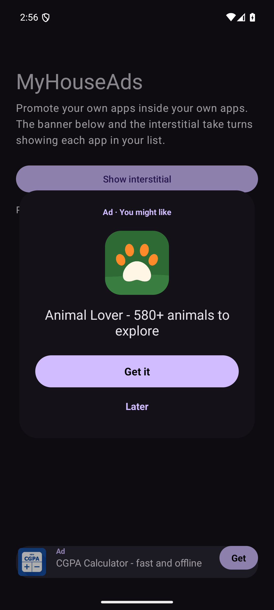

# MyHouseAdsAndroid

Promote your own Android apps inside your own Android apps. MyHouseAdsAndroid shows a small banner and a full interstitial for your other apps, loaded from a JSON file you host or from a list in your code. No ad network, no account, no revenue share.

Each time an ad is shown, the next app in your list is used, so all your apps get their turn. The ads take their colors from your app's theme, so they look right in light and dark mode.

## Screenshots

| Light | Dark |
|---|---|
|  |  |

## Features

1. **Banner ad:** your app's icon, a short line of text and a "Get" button. Tapping it opens your link.
2. **Interstitial ad:** a centered card with a big icon, "Get it" and "Later".
3. **Ad on back press:** the close button says "Exit" and closes the screen, so the ad never traps your users.
4. **Two ways to feed it:** a JSON file at any URL, or `MyAd` items in code.
5. **Follows your theme:** uses your app's primary color and background, in light and dark mode.
6. **Small:** no image or network library is added to your app.

## Install

Add JitPack to `settings.gradle.kts`:

```kotlin
dependencyResolutionManagement {
    repositories {
        google()
        mavenCentral()
        maven("https://jitpack.io")
    }
}
```

Add the dependency:

```kotlin
dependencies {
    implementation("com.github.p32929:MyHouseAdsAndroid:2.0.0")
}
```

Requires Android 5.0 (API 21) or newer. Your app's theme should be an AppCompat or Material theme.

## The JSON file

Host a JSON file anywhere (GitHub, a Gist, your own server). The format is the same as in version 1. See [docs/sample-ads.json](docs/sample-ads.json).

```json
[
  {
    "appIconStr": "https://example.com/icon.png",
    "appDescription": "My App - what it does in a few words",
    "url": "https://play.google.com/store/apps/details?id=com.example.myapp"
  }
]
```

## How to use

Kotlin:

```kotlin
// Banner goes into this LinearLayout. Pass null if you only want interstitials.
val ads = MyAdsAdder(this, linearLayout, "https://example.com/house_ads.json")

// Or from code
val ads = MyAdsAdder(
    this, linearLayout,
    MyAd("https://example.com/icon.png", "My App - what it does", "https://example.com/myapp"),
    MyAd(R.drawable.other_icon, "Other App - what it does", "https://example.com/other"),
)

// Show an interstitial anywhere
ads.showInterAd(this, false)

// Show one when the user presses back. Returns false if no ads are loaded yet.
onBackPressedDispatcher.addCallback(this, object : OnBackPressedCallback(true) {
    override fun handleOnBackPressed() {
        if (!ads.showInterAd(this@MainActivity, true)) {
            isEnabled = false
            onBackPressedDispatcher.onBackPressed()
        }
    }
})
```

Java:

```java
MyAdsAdder ads = new MyAdsAdder(this, linearLayout, "https://example.com/house_ads.json");

ads.showInterAd(this, false);
```

## Migrating from 1.x

1. The class and method names are the same: `MyAdsAdder`, `MyAd`, `showInterAd`. Most apps only need the new version number.
2. The library is now in Kotlin and uses AndroidX. Your app must use AndroidX, not the old support library.
3. The minimum Android version is now 5.0 (API 21).
4. If the JSON can't be loaded, the library no longer shows a Toast to your users. It writes a warning to Logcat (tag `MyHouseAds`).
5. `JsonObjectGetter`, `JsonObjectGetListener` and `FayazSP` are removed. They were helpers inside the library.
6. Picasso is no longer a dependency. Icons are loaded by the library itself.
7. `MyAdsAdder(context, layout, ads...)` now also works with icon URLs, not only drawables.

If you want rotating banners and a rating dialog too, see the sibling library [HouseAds2](https://github.com/p32929/HouseAds2).

## License

MIT License — Copyright (c) 2019 Fayaz Bin Salam. See [LICENSE](LICENSE) for the full text.

## Contributing

Contributions are very welcome, thank you! Before you start on a pull request, please open an issue and tell me what you would like to add or change. That way we can agree on it first, and your time is not wasted on something that might not fit. Thanks for helping make MyHouseAdsAndroid better.

## You might also like

<p><a href="https://openstore.pfay.workers.dev/more/p32929/myhouseadsandroid/0"><picture><source media="(prefers-color-scheme: dark)" srcset="https://openstore.pfay.workers.dev/more/p32929/myhouseadsandroid/0-dark.svg"></picture></a><a href="https://openstore.pfay.workers.dev/more/p32929/myhouseadsandroid/1"><picture><source media="(prefers-color-scheme: dark)" srcset="https://openstore.pfay.workers.dev/more/p32929/myhouseadsandroid/1-dark.svg"></picture></a><br><a href="https://openstore.pfay.workers.dev/more/p32929/myhouseadsandroid/2"><picture><source media="(prefers-color-scheme: dark)" srcset="https://openstore.pfay.workers.dev/more/p32929/myhouseadsandroid/2-dark.svg"></picture></a><a href="https://openstore.pfay.workers.dev/more/p32929/myhouseadsandroid/3"><picture><source media="(prefers-color-scheme: dark)" srcset="https://openstore.pfay.workers.dev/more/p32929/myhouseadsandroid/3-dark.svg"></picture></a></p>

<p><a href="https://p32929.github.io/share/?repo=MyHouseAdsAndroid"><picture><source media="(prefers-color-scheme: dark)" srcset="https://p32929.github.io/readme/footer-share-dark.svg"></picture></a><a href="https://p32929.github.io/support/"><picture><source media="(prefers-color-scheme: dark)" srcset="https://p32929.github.io/readme/footer-support-dark.svg"></picture></a><br><a href="https://openstore.pfay.workers.dev/add"><picture><source media="(prefers-color-scheme: dark)" srcset="https://p32929.github.io/readme/footer-join-dark.svg"></picture></a></p>
